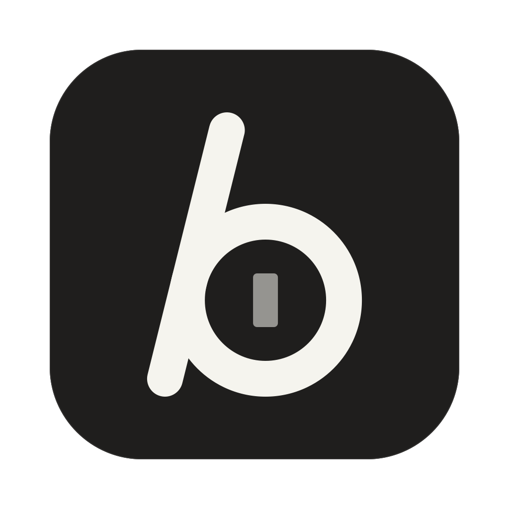
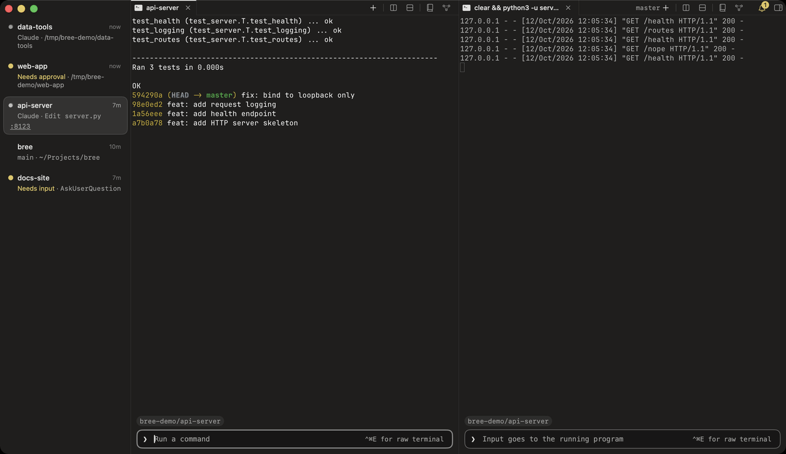
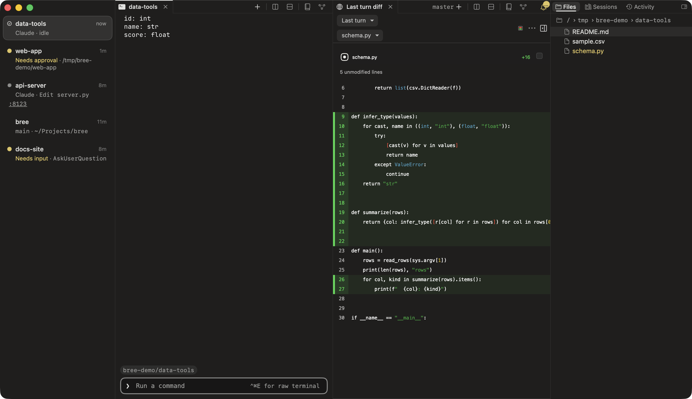
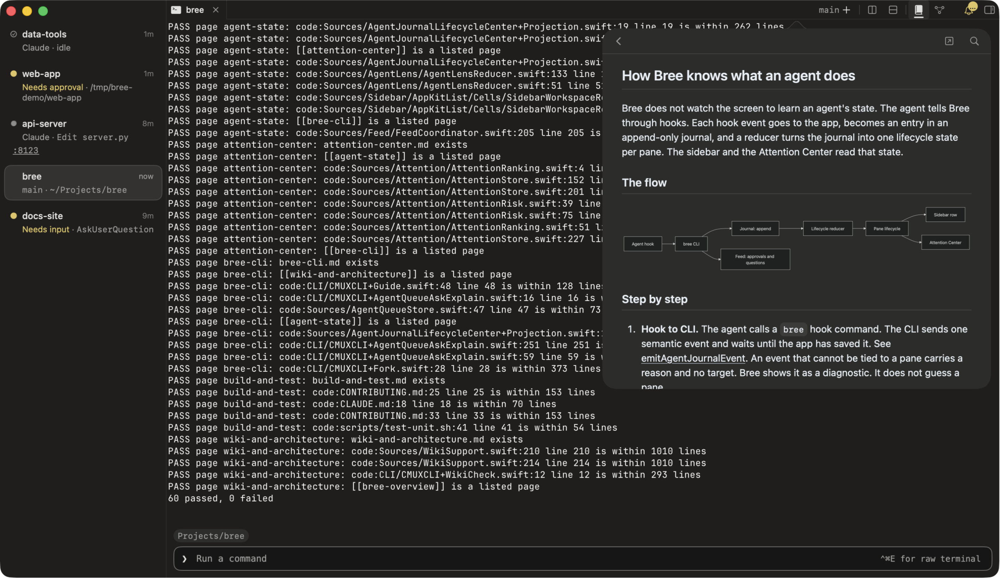
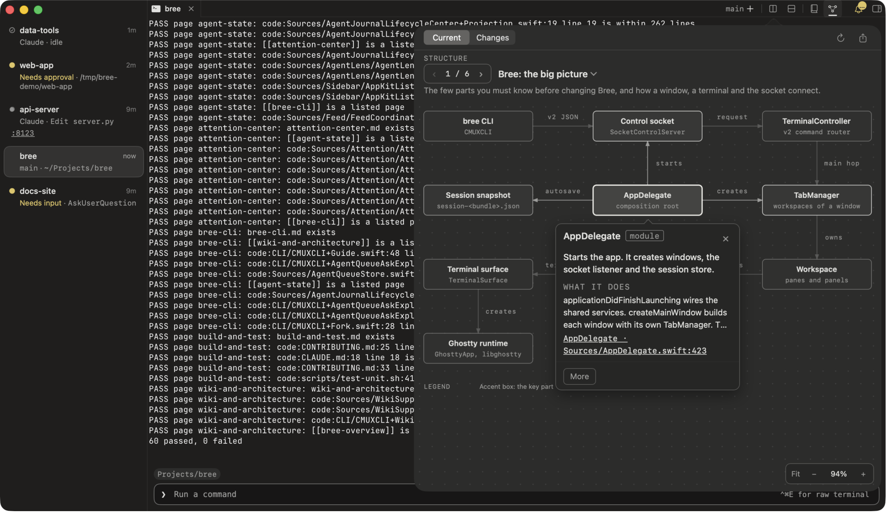

<p align="center">
  
</p>

<h1 align="center">Bree</h1>

<p align="center">
  <b>A calm macOS terminal for running many coding agents side by side.</b><br>
  Local only. No account, no telemetry, no auto-update.
</p>

<p align="center">
  <a href="https://github.com/ecyx00/bree/releases/latest">Download</a> ·
  <a href="#install">Install</a> ·
  <a href="#build-from-source">Build from source</a> ·
  <a href="docs/releases/0.1.0.md">Release notes</a>
</p>

<p align="center">
  
</p>

When you run several agents at once, the hard part is not the terminal. It is knowing which agent works, which one waits for you, and what each one changed. Bree puts that in one window. Each workspace row tells you what its agent does now. One panel collects everything that waits for you. One click shows the diff of an agent's last turn.

Bree is built on [Ghostty](https://github.com/ghostty-org/ghostty) and is a hard fork of [cmux](https://github.com/manaflow-ai/cmux). It keeps the fast GPU terminal, vertical tabs, split panes and the scriptable socket and CLI, and it adds the agent tools below.

## See every agent at a glance

Each sidebar row shows its agent's state: **Running**, **Needs approval**, **Needs input** or done. Bree learns the state from the agent's hooks, not from the screen, so the row is right even when the pane is hidden. Rows never reorder, so a workspace stays where you left it.

## Answer what waits for you

The Attention Center (⌘I) ranks the panes that need you. An approval shows the exact command, and a risk note when the command matches a risk rule, such as a recursive delete or a force push. Snooze an item when it can wait. Jump to the pane with one click.

## Review each agent turn

<p align="center">
  
</p>

Bree records where each agent turn starts and ends. Open the diff of the last turn next to the terminal, read it, and send review comments back to the agent.

## Learn the code you work in

<table>
  <tr>
    <td width="50%"></td>
    <td width="50%"></td>
  </tr>
  <tr>
    <td><b>Wiki</b> (⌥⌘K): pages about the project, with links that open the code at the exact line.</td>
    <td><b>Architecture</b> (⌥⌘A): diagrams you read in order. Click a part to see what it does, why it exists and where its code is.</td>
  </tr>
</table>

Your coding agents write both. `bree guide wiki` and `bree guide architecture` tell an agent the format, and `bree wiki check` and `bree architecture check` verify the result.

## A CLI your agents can use

Agents inside Bree can talk back to you without typing over you:

```bash
bree ask-human "Which package manager?" -o npm -o pnpm   # waits for your choice in the Inbox
bree queue "Run the tests again"                          # types it when the agent comes to rest
bree agent explain                                        # why this pane shows its state
bree guide                                                # the full guide, written for agents
```

When a script or agent changes the UI through the socket, Bree shows a short toast, so you see what it did.

## Everything one keystroke away

The command palette (⌘⇧P) groups every command by what it acts on: Workspace, Pane, Agent, View, Learn and App. Bree also has a bottom panel (⌘J), a Quick View for HTML, CSV, JSONL and image folders, a shell editor, an image strip, pinned project files, keyboard focus regions, and a resource guard that pauses panes that run hot.

## Install

1. Download `Bree-0.1.0-arm64.zip` and its `.sha256` file from the [latest release](https://github.com/ecyx00/bree/releases/latest).
2. Check the download: `shasum -a 256 -c Bree-0.1.0-arm64.zip.sha256`
3. Unzip it and move `Bree.app` to `/Applications`.
4. Bree is ad-hoc signed and not notarized, so macOS blocks the first launch. Control-click `Bree.app` and choose **Open**, or run `xattr -dr com.apple.quarantine /Applications/Bree.app`.
5. Optional: put the CLI on your PATH:
   ```bash
   ln -s /Applications/Bree.app/Contents/Resources/bin/bree /usr/local/bin/bree
   ```

Requires Apple Silicon and macOS 14 or later. Bree does not update itself. To update, install a newer release over the old app. Bree has its own bundle id (`com.bree.app`) and its own state folders, so it runs next to cmux without sharing anything.

## Build from source

You need the Xcode version in `.xcode-version` with the Metal toolchain, `zig` 0.16 (`brew install zig@0.16`) and `rustup`.

```bash
git clone https://github.com/ecyx00/bree.git
cd bree
./scripts/setup.sh                  # checks tools and provisions GhosttyKit
./scripts/build-bree.sh             # Release build, ad-hoc signed
./scripts/build-bree.sh --install   # also copy it to /Applications/Bree.app
./scripts/build-bree.sh --package   # dist/Bree-<version>-arm64.zip and .sha256
```

The first build compiles GhosttyKit from the vendored `ghostty/` source with Zig and caches it under `~/.cache/cmux/ghosttykit`. For development builds and tests, see [CONTRIBUTING.md](CONTRIBUTING.md). `python3 scripts/verify-local.py` runs the fast local checks.

## How Bree differs from cmux

**Removed:** cloud VMs, accounts and sign-in, Sparkle auto-update, telemetry, the GitHub PR poller, iPhone pairing, Mac-to-Mac devices, Hive, Canvas layout mode, the window-level Dock, the iOS simulator panel, agent-chat panels and checkpoint storage.

**Kept:** SSH (browser proxy, port forwarding, remote file preview, remote tmux), SSH-TUI, webhooks, the Agent Inbox, Sessions and `bree fork`.

**Added:** the agent states in the sidebar, the Attention Center with risk notes, turn review, the Wiki and Architecture popovers, the agent CLI (`ask-human`, `queue`, `agent explain`, `guide`), the remote-action toast, a dark-only look whose chrome follows your terminal theme, and its own identity (`~/.bree`, `Application Support/Bree`, `bree.sock`).

## Privacy

Bree has no telemetry, no crash reporter, no account and no update check. It uses the network only when you do: a browser pane, an SSH host, a webhook you set up. Everything it stores stays on your Mac, under `~/.bree` and `~/Library/Application Support/Bree`.

## License and attribution

Bree is a modified version of cmux (modified 2026) and is licensed under GPL-3.0-or-later, as is cmux. This repository's history starts at the Bree initial commit. The upstream history is in the cmux repository. See [LICENSE](LICENSE): copyright (c) 2024-present Manaflow, Inc. Other contributors and third parties keep the copyright in their material. Third-party notices, including Ghostty (MIT, Copyright (c) 2024 Mitchell Hashimoto, Ghostty contributors), are in [THIRD_PARTY_LICENSES.md](THIRD_PARTY_LICENSES.md). Bree is not affiliated with or endorsed by Manaflow or the Ghostty project.
